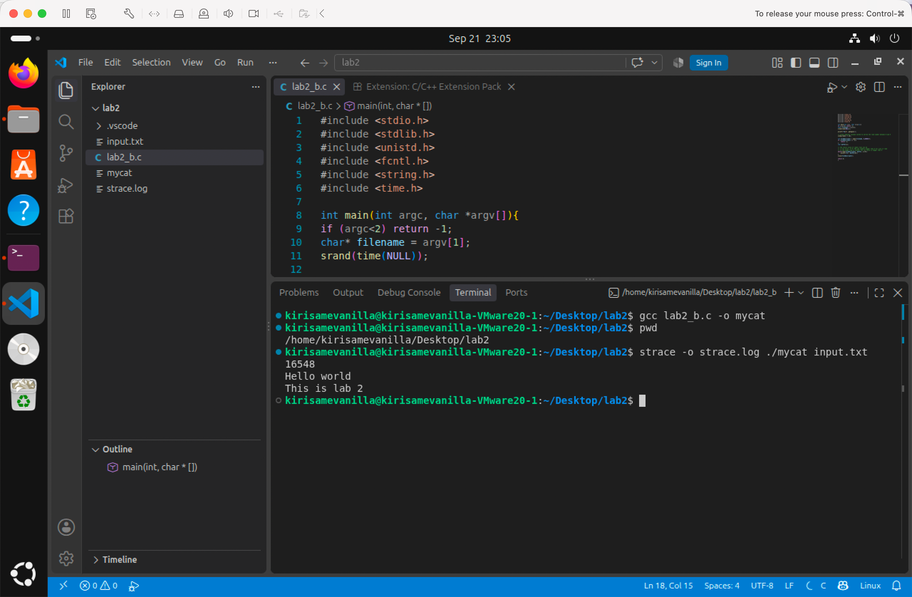
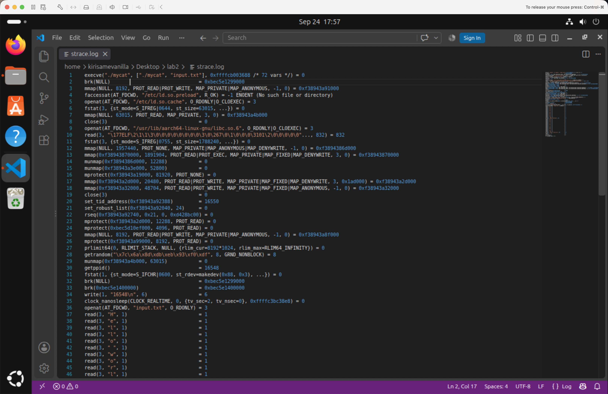
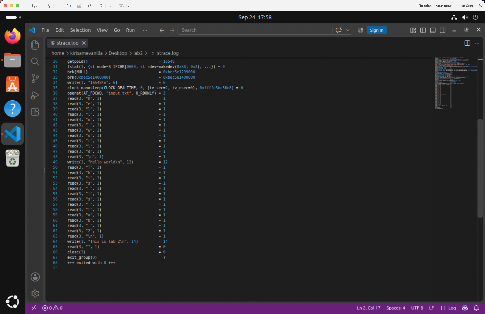

---
header-includes:
  - \usepackage{fvextra}
  - \DefineVerbatimEnvironment{Highlighting}{Verbatim}{breaklines,commandchars=\\\{\}}
---
# Lab2

## Questions

1. What are the system call names for getting the parent process ID, opening a file, closing a file, reading a file,
printing to the console and sleeping?

    Answer:  

    |Function|System call name|
    |-|-|
    |Getting the parrent process ID|getppid|
    |Opening a file|openat|
    |Closing a file|close|
    |Reading a file|read|
    |Printing to the console|write|
    |Sleeping|clock_nanosleep|

2. What are the number of system calls for opening, closing and reading the file(s) (i.e. how many times each
was called).

    Answer:

    - For file `input.txt` only:

      |Function|Count|
      |-|-|
      |Opening the file|1|
      |Closing the file|1|
      |Reading the file|27 (26 successful one-byte reads because of the one-byte buffer i create and one final read returning 0 at EOF)|

    - For the whole process, it contains additional openat/read/close calls made during program initialization

      |Function|Count|
      |-|-|
      |Opening the file|3|
      |Closing the file|3|
      |Reading the file|28|

3. What are the number of system calls for printing to the screen? (count each individually. You may either use
strace options to aid you in doing so, or you may use grep).

    Answer:

    3 times of system call `write`.  
    

4. What was the value of the file descriptor of your read file (please review the lecture slides before asking what
this means)?

    Answer:

    3

## Attachments

### Program Run Result



### Strace Log




``` log
execve("./mycat", ["./mycat", "input.txt"], 0xffffcb003688 /* 72 vars */) = 0
brk(NULL)                               = 0xbec5e1299000
mmap(NULL, 8192, PROT_READ|PROT_WRITE, MAP_PRIVATE|MAP_ANONYMOUS, -1, 0) = 0xf38943a91000
faccessat(AT_FDCWD, "/etc/ld.so.preload", R_OK) = -1 ENOENT (No such file or directory)
openat(AT_FDCWD, "/etc/ld.so.cache", O_RDONLY|O_CLOEXEC) = 3
fstat(3, {st_mode=S_IFREG|0644, st_size=63015, ...}) = 0
mmap(NULL, 63015, PROT_READ, MAP_PRIVATE, 3, 0) = 0xf38943a4b000
close(3)                                = 0
openat(AT_FDCWD, "/usr/lib/aarch64-linux-gnu/libc.so.6", O_RDONLY|O_CLOEXEC) = 3
read(3, "\177ELF\2\1\1\3\0\0\0\0\0\0\0\0\3\0\267\0\1\0\0\0\3101\2\0\0\0\0\0"..., 832) = 832
fstat(3, {st_mode=S_IFREG|0755, st_size=1788240, ...}) = 0
mmap(NULL, 1957440, PROT_NONE, MAP_PRIVATE|MAP_ANONYMOUS|MAP_DENYWRITE, -1, 0) = 0xf3894386d000
mmap(0xf38943870000, 1891904, PROT_READ|PROT_EXEC, MAP_PRIVATE|MAP_FIXED|MAP_DENYWRITE, 3, 0) = 0xf38943870000
munmap(0xf3894386d000, 12288)           = 0
munmap(0xf38943a3e000, 52800)           = 0
mprotect(0xf38943a19000, 81920, PROT_NONE) = 0
mmap(0xf38943a2d000, 20480, PROT_READ|PROT_WRITE, MAP_PRIVATE|MAP_FIXED|MAP_DENYWRITE, 3, 0x1ad000) = 0xf38943a2d000
mmap(0xf38943a32000, 48704, PROT_READ|PROT_WRITE, MAP_PRIVATE|MAP_FIXED|MAP_ANONYMOUS, -1, 0) = 0xf38943a32000
close(3)                                = 0
set_tid_address(0xf38943a92388)         = 16550
set_robust_list(0xf38943a92040, 24)     = 0
rseq(0xf38943a92740, 0x21, 0, 0xd428bc00) = 0
mprotect(0xf38943a2d000, 12288, PROT_READ) = 0
mprotect(0xbec5d10ef000, 4096, PROT_READ) = 0
mmap(NULL, 8192, PROT_READ|PROT_WRITE, MAP_PRIVATE|MAP_ANONYMOUS, -1, 0) = 0xf38943a8f000
mprotect(0xf38943a99000, 8192, PROT_READ) = 0
prlimit64(0, RLIMIT_STACK, NULL, {rlim_cur=8192*1024, rlim_max=RLIM64_INFINITY}) = 0
getrandom("\x7c\x6a\x8d\xdb\xeb\x93\xf0\xdf", 8, GRND_NONBLOCK) = 8
munmap(0xf38943a4b000, 63015)           = 0
getppid()                               = 16548
fstat(1, {st_mode=S_IFCHR|0600, st_rdev=makedev(0x88, 0x3), ...}) = 0
brk(NULL)                               = 0xbec5e1299000
brk(0xbec5e1400000)                     = 0xbec5e1400000
write(1, "16548\n", 6)                  = 6
clock_nanosleep(CLOCK_REALTIME, 0, {tv_sec=2, tv_nsec=0}, 0xffffc3bc38e8) = 0
openat(AT_FDCWD, "input.txt", O_RDONLY) = 3
read(3, "H", 1)                         = 1
read(3, "e", 1)                         = 1
read(3, "l", 1)                         = 1
read(3, "l", 1)                         = 1
read(3, "o", 1)                         = 1
read(3, " ", 1)                         = 1
read(3, "w", 1)                         = 1
read(3, "o", 1)                         = 1
read(3, "r", 1)                         = 1
read(3, "l", 1)                         = 1
read(3, "d", 1)                         = 1
read(3, "\n", 1)                        = 1
write(1, "Hello world\n", 12)           = 12
read(3, "T", 1)                         = 1
read(3, "h", 1)                         = 1
read(3, "i", 1)                         = 1
read(3, "s", 1)                         = 1
read(3, " ", 1)                         = 1
read(3, "i", 1)                         = 1
read(3, "s", 1)                         = 1
read(3, " ", 1)                         = 1
read(3, "l", 1)                         = 1
read(3, "a", 1)                         = 1
read(3, "b", 1)                         = 1
read(3, " ", 1)                         = 1
read(3, "2", 1)                         = 1
read(3, "\n", 1)                        = 1
write(1, "This is lab 2\n", 14)         = 14
read(3, "", 1)                          = 0
close(3)                                = 0
exit_group(0)                           = ?
+++ exited with 0 +++
```
