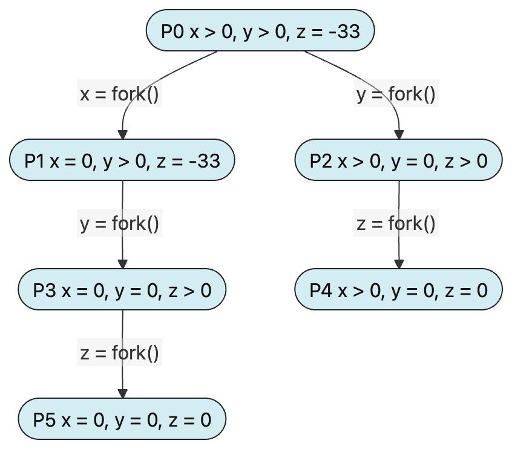
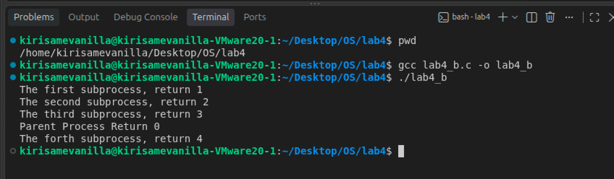
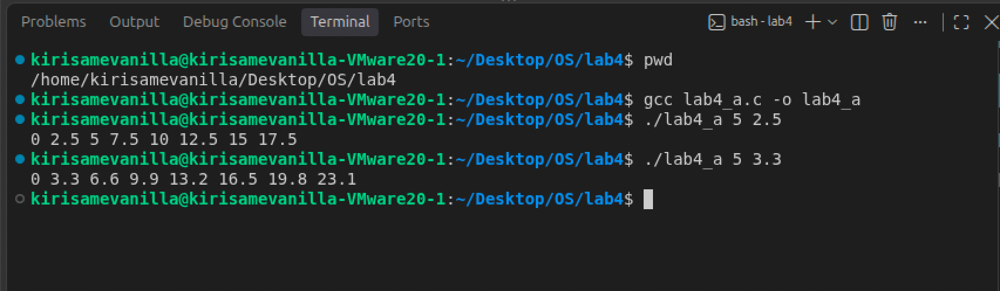
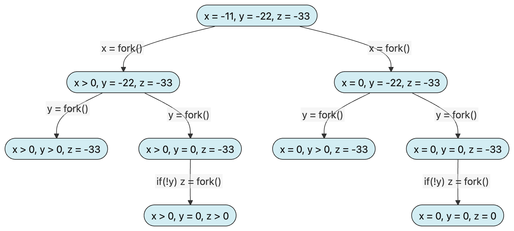
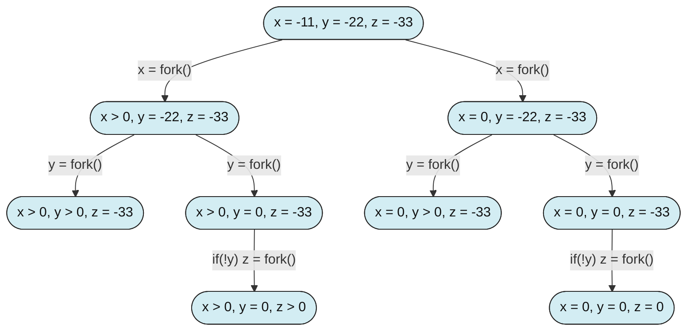
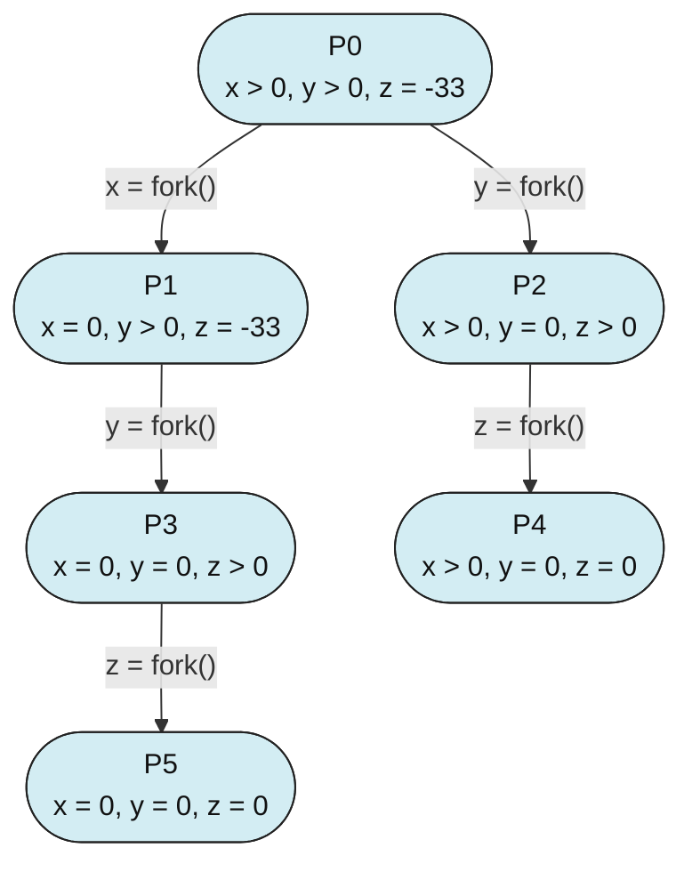

# Assignment 4

> Why there are two question A?

## Answer

### A

\newpage

### B

### Second A

\newpage

## Attachments

### Question A Procedure Mermaid

### Question A Process Tree Mermaid

