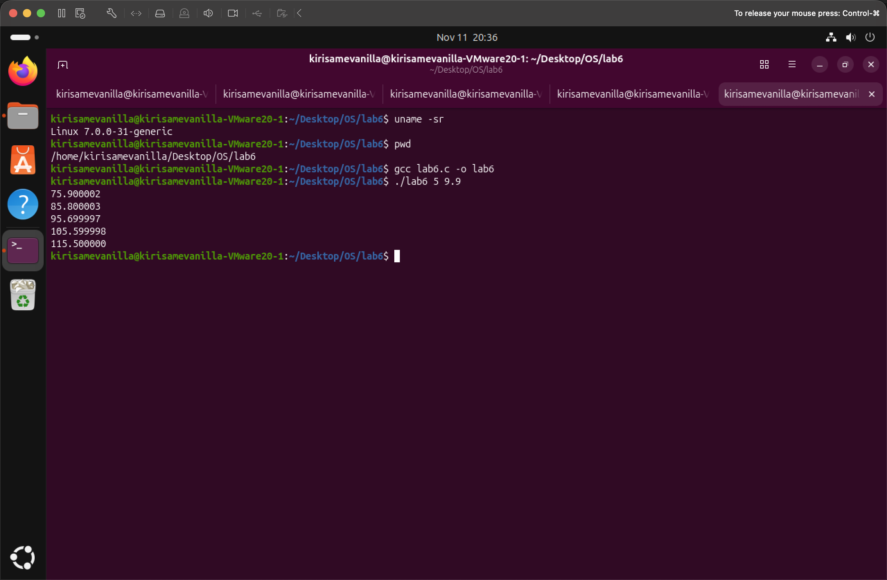

# Assignment 6

## Part A

## Part B

1. Which of the calls above are blocking and which are not?

    - blocking: write(), read(), connect(), accept()  
    - non-blocking: socket(), bind(), listen()

2. Is this a form of direct communications or indirect communications?

    - this is indirect communication because it use an address and a port

3. What is the failure flag returned from connect() that indicates the server is not ready?

    - connect() returns -1, and errno is ECONNREFUSED

4. How would you change your program to communicate between processes in different machines?

    - First, split the parent and child logic into to programs so that the server side and the client side can run independently.  
    - Second, change the `address.sin_addr.s_addr = htonl(0x7f000001U);` to `0.0.0.0` so that it listens in local network.
